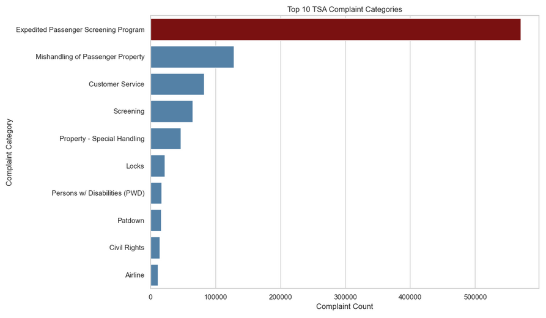

# TSA Complaints Analysis

## Project overview

This project examines patterns in Transportation Security Administration (TSA) complaint counts across airports, complaint categories, and time. It is intended to help operational leaders identify where a closer review of traveler concerns may be useful.

The analysis uses Python to prepare the data and create charts showing complaint trends, high-volume airports and categories, and the geographic distribution of complaints.

## Questions explored

- How has complaint volume changed over time?
- Which airports and complaint categories have the highest recorded counts?
- How do complaint counts vary across years and locations?
- Where might a targeted operational review be useful?

## Data Sources and Attribution

The complaint records originated in reports published by the Transportation Security Administration (TSA). This analysis uses CSV files extracted and standardized by the [Data Liberation Project](https://github.com/data-liberation-project/tsa-complaint-counts), supplied through the course materials (Data Liberation Project, n.d.).

The repository includes three complaint datasets:

- `complaints-by-airport.csv`: Complaint counts by airport and month.
- `complaints-by-category.csv`: Complaint counts by airport, month, and category.
- `complaints-by-subcategory.csv`: Complaint counts by airport, month, category, and subcategory.

These files represent different aggregation levels of the complaint records and should not be added together to calculate an overall total.

Airport names, codes, and geographic coordinates are supplied by the [IP2Location IATA/ICAO List](https://github.com/ip2location/ip2location-iata-icao), stored locally as `iata-icao.csv` (IP2Location, n.d.).

This project includes IATA/ICAO List data available from https://github.com/ip2location/ip2location-iata-icao.

The Data Liberation Project’s standardized CSV files and the IP2Location airport lookup are distributed under [Creative Commons Attribution-ShareAlike 4.0 International](https://creativecommons.org/licenses/by-sa/4.0/).

The analysis uses the copies included in this repository. Upstream datasets may change, so reproducing the reported results requires retaining these project files.

## Approach

The Jupyter notebook loads complaint counts by airport, category, and subcategory, along with an airport-code lookup file. It standardizes dates and airport codes, joins airport information for mapping, and produces time-series, bar, heat-map, distribution, and geographic visualizations.

## Main takeaway

Complaint counts are concentrated among certain airports and categories and vary over time. These patterns can help prioritize further investigation. A high count alone does not establish poor performance: airports differ in passenger volume, and the dataset does not show whether individual complaints were substantiated.



## Repository contents

| Path | Contents |
|---|---|
| [`notebook/TSA_Complaints_Analysis.ipynb`](notebook/TSA_Complaints_Analysis.ipynb) | Data preparation, charts, interpretation, and recommendations |
| [`data/`](data/) | Complaint datasets and airport-code lookup |
| [`images/`](images/) | Exported project visualizations |
| [`presentation/`](presentation/) | PDF version of PowerPoint presentation summarizing the analysis |
| [`requirements.txt`](requirements.txt) | Python packages used by the project |

## Run the notebook

1. Clone or download this repository.
2. Extract `data/complaints-by-subcategory.zip` so that `data/complaints-by-subcategory.csv` exists.
3. Install the packages listed in `requirements.txt`:

   ```bash
   pip install -r requirements.txt
   ```

4. Open `notebook/TSA_Complaints_Analysis.ipynb` in Jupyter and run the cells in order. The notebook reads files using paths relative to the `notebook` folder.

## Limitations and responsible use

These are complaint **counts**, not rates per passenger or screening event. Differences between airports may reflect differences in traffic volume, reporting practices, or other conditions. Records without usable location information cannot be shown accurately on a map. The charts identify patterns for review; they do not establish why complaints occurred or assign fault to an airport or its staff.

Changes in complaint-submission systems and reporting practices can affect comparisons over time. The source documentation also identifies missing airport codes and ambiguous or truncated complaint subcategories. Records without usable airport information cannot be assigned reliably to a location, and some subcategory totals require cautious interpretation. These limitations supplement the absence of passenger-volume data.

## Next steps

A useful extension would compare complaints with passenger volume, examine changes within individual airports, and document the dataset’s coverage and reporting definitions more fully.

## References

Data Liberation Project. (n.d.). *TSA complaint counts* [Data set]. GitHub. https://github.com/data-liberation-project/tsa-complaint-counts

IP2Location. (n.d.). *IATA/ICAO list* [Data set]. GitHub. https://github.com/ip2location/ip2location-iata-icao
